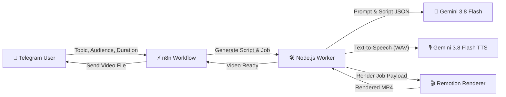

# YouTube Shorts Studio

An automated, AI-powered pipeline to generate animated coding educational YouTube Shorts from a single Telegram prompt.

---

## 🏗️ Architecture Overview



### Pipeline Flow
1. **Telegram Trigger:** User sends video details (`Topic`, `Audience`, `Language`, `Duration`) via Telegram bot.
2. **n8n Orchestrator:** Parses the incoming text and invokes the worker backend.
3. **Node.js Worker (`/scripts/generate`):**
   - Calls **Gemini 3.8 Flash** with structured prompts to generate scene-by-scene script JSON (hook, explanation, code, example, outro).
   - Persists requests and scripts in PostgreSQL.
4. **Voiceover Generation (`/jobs/:id/process`):**
   - Synthesizes spoken voiceover via **Gemini Flash TTS** (`Puck` voice in Indian Hinglish/English style).
   - Computes precise audio durations with `ffprobe` and calculates scene frame budgets.
5. **Remotion Renderer (`/render`):**
   - Renders motion graphics, code editor animations, captions, and sound effects to 1080x1920 MP4 video.
6. **Delivery:** Completed video file is sent back directly to the user via Telegram.

---

## 📋 Prerequisites

- **Docker & Docker Compose** (Docker Desktop on Windows/macOS or Docker Engine on Linux)
- **Node.js 20+** (if running services locally outside Docker)
- **FFmpeg & FFprobe** (installed in containers; required on host only for local worker development)
- **Google Gemini API Key** (with access to Gemini text and TTS models)
- **Telegram Bot Token** (from `@BotFather` for the n8n trigger)

---

## 🚀 Quickstart

### 1. Clone the repository
```bash
git clone https://github.com/your-username/youtube-shorts-studio.git
cd youtube-shorts-studio
```

### 2. Configure Environment Variables
Copy `.env.example` to `.env` and fill in your credentials:
```bash
cp .env.example .env
```

| Variable | Description | Example |
| :--- | :--- | :--- |
| `POSTGRES_DB` | PostgreSQL database name | `n8n` |
| `POSTGRES_USER` | PostgreSQL username | `studio_admin` |
| `POSTGRES_PASSWORD` | PostgreSQL password | Strong random password |
| `N8N_ENCRYPTION_KEY` | n8n encryption key (32 hex characters) | Random 32 hex chars |
| `N8N_WEBHOOK_URL` | *(Optional)* Public URL for Telegram webhooks | `https://your-tunnel.trycloudflare.com/` |
| `GEMINI_API_KEY` | Google Gemini API Key | `AIza...` |

### 3. Launch with Docker Compose
```bash
docker compose up -d --build
```

### 4. Verify Services
Check running containers:
```bash
docker compose ps
```
- **n8n:** `http://localhost:5678`
- **Worker API:** `http://localhost:5001` (health check: `http://localhost:5001/health`)
- **Remotion Renderer:** Internal `http://renderer:5002` (accessible within Docker network)
- **PostgreSQL:** `localhost:5432`

### 5. Import the n8n Pipeline
1. Open n8n at `http://localhost:5678`.
2. Set up your Telegram Bot credential under **Credentials** > **Telegram API**.
3. Import the workflow from [`n8n/YouTube_Shorts_Studio_Main_Pipeline.json`](n8n/YouTube_Shorts_Studio_Main_Pipeline.json).
4. Activate the workflow.

---

## 📁 Project Structure

```
youtube-shorts-studio/
├── docker-compose.yml              # Multi-container orchestration (PostgreSQL, n8n, renderer, worker)
├── .env.example                    # Root environment variable template
├── .gitignore                      # Git ignore rules for node_modules, outputs, secrets
├── .dockerignore                   # Docker context ignore rules
├── n8n/
│   └── YouTube_Shorts_Studio_Main_Pipeline.json  # Exported n8n workflow
├── renderer/                       # Remotion video rendering service
│   ├── Dockerfile                  # Slim Debian image with Chromium dependencies & Remotion browser
│   ├── package.json
│   ├── remotion.config.ts          # Remotion studio configuration
│   ├── server.js                   # Express server wrapping Remotion bundle & renderMedia
│   ├── public/audio/               # Background music and UI sound effects
│   └── src/
│       ├── Composition.tsx         # Main dynamic 9:16 Shorts composition
│       ├── PremiumPrototype.tsx    # Standalone demo composition
│       ├── Root.tsx                # Remotion root register
│       └── index.ts
└── worker/                         # Business logic & AI orchestration
    ├── Dockerfile                  # Node.js alpine image with FFmpeg
    ├── package.json
    └── src/
        └── server.js               # Express API: Gemini script generation, TTS, Remotion caller
```

---

## 🛠️ Worker API Endpoints

| Method | Endpoint | Description |
| :--- | :--- | :--- |
| `GET` | `/health` | Worker service health check |
| `GET` | `/health/db` | Database connectivity check |
| `POST` | `/scripts/generate` | Generates a structured multi-scene script via Gemini |
| `POST` | `/jobs` | Creates a video job for an existing request |
| `POST` | `/jobs/:id/process` | Generates TTS voiceover, measures audio, and triggers video rendering |
| `GET` | `/jobs/:id` | Returns job status (`queued`, `processing`, `completed`, `failed`) |
| `GET` | `/jobs/:id/video` | Downloads the completed `.mp4` video file |

---

## 🧪 Local Development

### Remotion Studio Preview
To preview and tweak video compositions in the browser:
```bash
cd renderer
npm install
npm run dev
```

### Worker Unit / Manual Run
```bash
cd worker
npm install
npm start
```

---